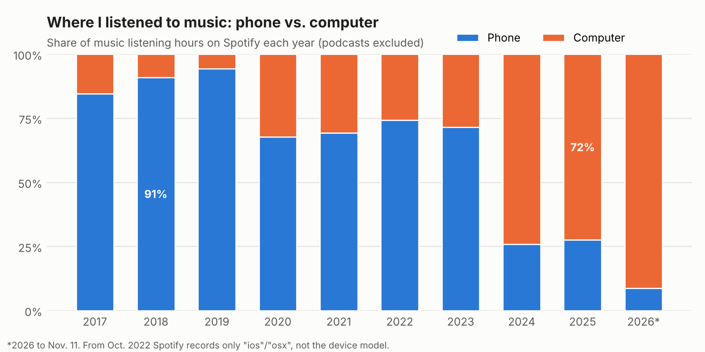

For my personal data project, I originally wanted to document how my music listening habits have changed since 2018. I planned to use my Spotify extended listening history as my data source and organize it in a spreadsheet, with each listening event recorded separately.

October 3

After receiving feedback from Dr. Graham, I decided to focus more on the material circumstances of listening rather than just changes in musical taste.

My new research question is:

How has the material infrastructure through which I listen to music changed since 2018, and how has that shaped my listening?

One problem will be reconstructing what devices I was using at different points since 2018. For devices I still have, I can photograph and document them directly. For older devices, I may need to use photographs, receipts, account information, emails, or my own memory to work out approximately when I used them. I will need to distinguish between dates I can establish from evidence and dates that are only approximate.

One difficulty with this approach is that I may be able to establish which devices I owned at a particular time without knowing exactly how often I used them to listen to music.

I also need to look more closely at the Spotify extended listening history to see whether it contains information about the device or platform used for each listening event. If it does, this could help connect the Spotify data to the material history of my listening. If it does not, I will have to find other ways of making those connections.

Things I could potentially document:

Phones and computers I have used to listen to music

Headphones, earbuds, and speakers

Wired versus Bluetooth listening

Changes in where I listen to music

October 19

I've been thinking more about the limitations of the Spotify data, particularly how it records what I listened to without necessarily telling me much about the circumstances.

This relates to Hacıgüzeller's question of whether producing more maps necessarily means having more knowledge (Archaeology, Crafting Maps and Political Change, p. 81). I could have thousands of listening records but still know relatively little about how I was listening.

Huggett (sections 3.1 and 3.3) also discusses how digital technologies influence the production and interpretation of data. I think this applies to Spotify since I'm relying on information collected by the platform rather than recording it myself.

I still need to look more closely at what information is available in the listening history, particularly whether it records the devices I was using.

November 13

This week's network exercise made me consider whether my listening data could be treated as a network, with devices on one side and pieces of music on the other, linked whenever something was played on a device. Mills calls this a two-mode network, since it connects two different kinds of things, and notes that most material networks are of this kind (2017).

This would depend on whether the Spotify data records which device was used for each listening event, which I still need to check. Even if it does, it would probably not record headphones or speakers, so part of the network would always be missing. 

November 14

I downloaded my full Spotify extended listening history. It goes from October 2016 to November 2026 and has about 356,000 listening events. I left out the video files because they only have 431 events, mostly podcasts.

The data does record the device. Each listening event has a “platform” field that names the phone or computer and its operating system. From this I could work out which devices I used and when:

iPhone 4S: 2016 to September 2017

Windows PC: 2016 to 2018

Huawei P10: September 2017 to September 2020

Mac: from 2018

iPhone SE: from September 2020

In May 2022 the Mac entries change from Intel to Apple Silicon, so I probably got a new laptop around then. After October 14, 2022, Spotify only records “ios” or “osx” and not the model, so after that I can’t tell from the data alone which iPhone or Mac I was using. For that I will need receipts, photos or my memory. The data also doesn’t say anything about headphones or speakers.

The biggest change is that I moved from listening to music on my phone to listening on my computer. In 2018 and 2019 about 90% of my music listening was on my phone. It stayed around 70% until 2023. In 2024 this reversed, and in 2025 72% of my music listening was on my Mac. This is also when I started listening almost only to classical music. In 2025 I listened to about 1,190 hours of Bach.

Other fields show how the way I listened changed. In 2018, 93% of plays were on shuffle and 62% were offline downloads. By 2025 shuffle was down to about 40% and offline listening was at 0%. The share of plays that ran to the end of the track went from 14% in 2018 to 54% in 2025. This suggests I went from skipping through downloaded songs on my phone to playing whole pieces on my computer.

Podcasts make 2021 to 2023 harder to read, since I listened to about 1,200 hours of them in 2023. I counted them separately from music.

A track that plays to the end still doesn’t show that I was paying attention to it. As I wrote on October 19, the data records what played, not how closely I was listening.

November 20

I received the third and final Spotify data export, my Technical Log, which complements my Extended Listening History and Account Data.

The Account Data has a listening history that only covers November 2025 to November 2026, with no device field, so it adds little to the extended history. It does show how Spotify classifies me: a list of advertising "Inferences," and about 1,500 artists for whom I am a "Previously Active Listener," including Boys Noize and Keith Ape from the EDM and rap I listened to around 2018.

The Technical Log has 164 files of app events, but they only go back to April 2026, and most of the useful ones start in August.

The most useful file is AudioRouteSegmentEnd. It records which output each song played through, which is the part of my question the extended listening history could not answer. From August 20 to November 16 it has about 2,400 records:

MacBook Air, "External Headphones" (Apple wired earbuds in the headphone jack): 1,703

iPhone, EarPods: 496

iPhone speaker: 175

iPhone over Bluetooth to "Ioniq 5" (the car): 54

MacBook Air speakers: 11

In September most of my listening was on the MacBook with Apple wired earbuds plugged in (992 records against 99 on the iPhone with EarPods). In October most of it was on the iPhone with EarPods (380 records against 77 on the MacBook). On the iPhone, Spotify names the earbuds "EarPods"; on the MacBook it only records "External Headphones," because the headphone jack does not identify what is plugged into it.

The MacBook disappears from the technical log after October 24, but I did not stop listening on it. I now rarely use the Spotify app, and have begun mostly using the web player or YouTube instead, due to convenience and my preference for having fewer app icons open on the dock. The web player does not record the device model or the headphones, so the move from the MacBook to the iPhone in October is partly a change in what Spotify could record, not only in how I listened. Safari also reports my M1 MacBook as an “Intel Mac OS X 10_15_7,” because Apple freezes that part of the browser’s identification, so the browser records are less reliable about the device than the app records.

On YouTube I use regular YouTube with Premium, not YouTube Music, so that I can stream without ads, download videos, and listen to recordings that are not on Spotify. None of this appears in any of the Spotify exports.

The technical log also gives the model of each device instead of only "ios" or "osx." MacBookAir10,1 is the MacBook Air (M1, 2020) and iPhone17,5 is the iPhone 16e. iPhone12,8 is the iPhone SE (2nd generation), which matches the iPhone SE in the listening history. The iPhone SE appears until August 9, 2026 and the iPhone 16e from August 21, so I changed phones in the middle of August. This fills in part of the gap after October 2022, when the listening history stops naming the model.

This only covers the last few months, so for the headphones and speakers I used from 2018 to 2025 I will still need photographs, receipts and my memory. The exports also have to be kept apart: the listening history covers ten years with less detail, and the technical log covers a few months with much more.

The technical log also shows Spotify running its own models on my listening (files such as DaylistGenerated, DJNarrationServed and StutterPrediction, and a list of advertising "Inferences" in the account data). The data I am studying was produced partly for those systems.

I also downloaded my YouTube watch history from Google Takeout. It only goes back to May 31, 2026 and has 22,422 entries. Each entry has the title, channel and time, but no device, no length of viewing and nothing about downloads.

The history does not separate music from other videos, so I counted a video as music if it came from one of YouTube's automatic music channels (names ending in "- Topic", or VEVO) or if its title or channel had classical terms such as Bach, BWV, sonata, concerto or harpsichord. By these rules about 2,000 entries are music. Music on YouTube compared with Spotify plays, by month:

June: YouTube 633, Spotify 855

July: YouTube 379, Spotify 3,599

August: YouTube 291, Spotify 4,060

September: YouTube 149, Spotify 1,090

October: YouTube 305, Spotify 672

November (YouTube to the 20th, Spotify to the 18th): YouTube 252, Spotify 144

In November YouTube passes Spotify, which fits my move away from the Spotify app. The two are not the same unit, though: a Spotify play counts even if I skipped it after a few seconds, and a YouTube entry counts a video once however long I watched it.
