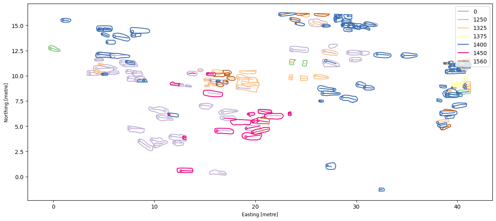

Opened the Linlithgow spatial notebook in Google Colab.

Ran the first cell to install the Python libraries. This worked without any errors.

Loaded the burial data and looked at the information it contained, including dates, age at death, burial position, sex, and grave shape.

Ran the mapping code and produced a map of the burials, with different colours representing their earliest possible dates.

Continued through several of the exercises involving burial dates, age groups, and individual burials.

I could see how the data could be used to look for patterns, although I wasn't always sure what those patterns meant.

Figure 1. Map of the Linlithgow burials generated using the course notebook.

