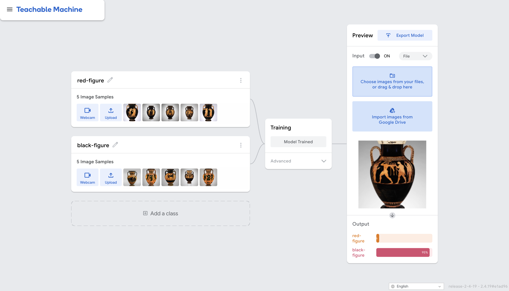
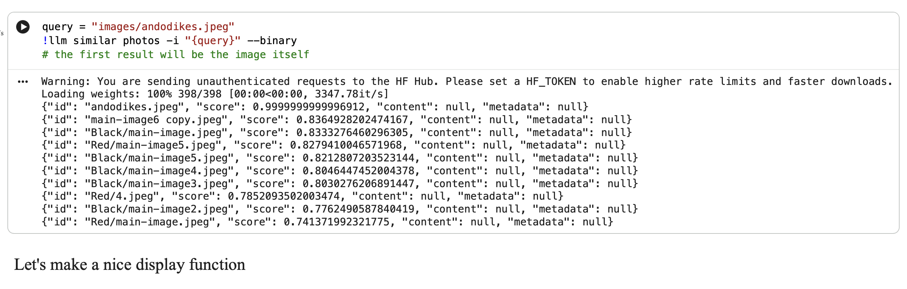
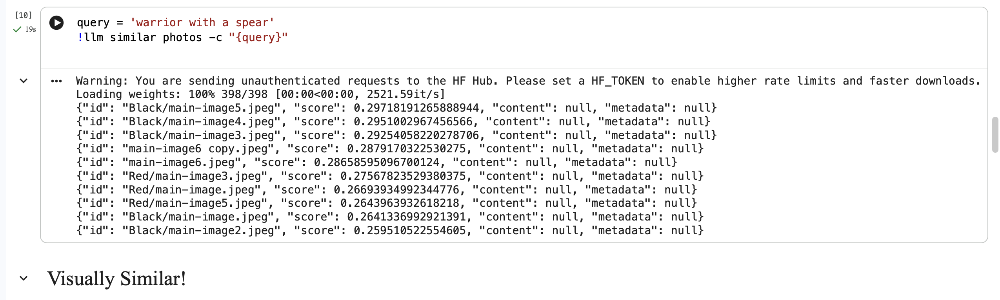

**November 20**

**Flinders Petrie language model**

Opened the Flinders Petrie notebook in Google Colab and checked that the runtime was T4 GPU.

The training cell failed the first time with “Variable model/wpe already exists,” because it had been run twice in the same session. I restarted the session and ran all the cells once.

The training then failed with “Dataset files are too small to sample 1024 tokens at a time.” The dataset had only 7 tokens. The notebook downloads Petrie’s books from Project Gutenberg, but Gutenberg has been down for several days, so the files were empty. On November 20 isitdownrightnow.com listed gutenberg.org as down: https://www.isitdownrightnow.com/gutenberg.org.html

The download cell starts with %%capture, which hides its output, so the failure only showed up at the training step. I could not generate any text from the prompt “Local workers are.”

**Teachable Machine**

Teachable Machine did not load in Safari, so I used Chrome.

Made an image model in Teachable Machine with two classes, red-figure and black-figure, using public-domain photographs of Attic amphorae and neck-amphorae from the Met’s collection. I left out fragments and drawings and uploaded 5 images per class.

Tested it on three vases that were not in the training set. It called a red-figure neck-amphora black-figure (77%), got a black-figure amphora right (100%), and called the red-figure side of the bilingual amphora signed by Andokides black-figure (95%).

Figure 1. Teachable Machine model and the Andokides test.

**ArchaeoCLIP**

Used the same photographs in the ArchaeoCLIP notebook: the 5 red-figure and 5 black-figure vases, the two test vases, and the Andokides amphora.

The notebook expects .jpg files in one folder, but my images were .jpeg and in two subfolders, so I changed the embedding command to ‘**/*.jpeg’. I also deleted the __MACOSX folder that the Mac adds to zip files, because its hidden files also end in .jpeg.

The cell meant to show where llm_clip.py is installed printed nothing, because I had not yet run the install cells. After installing, I edited lines 22 and 23 of llm_clip.py so it would use Dr. Graham and Eric Kansa’s model (sgraham/archae-ai) instead of the default CLIP model.

In the visually similar search for the red-figure side of the Andokides amphora, the closest image was the black-figure test vase (0.84). Five of the eight closest vases from the two folders were black-figure.

In the search by idea for “warrior with a spear,” none of the top three showed a warrior with a spear: the first was a woman with two bulls, the second satyrs and a woman, and the third a horseman. The only vase with a warrior holding a spear and shield ranked 9th. Every vase scored between 0.26 and 0.30.

Figure 2. ArchaeoCLIP search results.

**PDAP**

For my PDAP, went through the Spotify Technical Log export and my YouTube watch history from Google Takeout (cf. PDAP-update, November 20).
