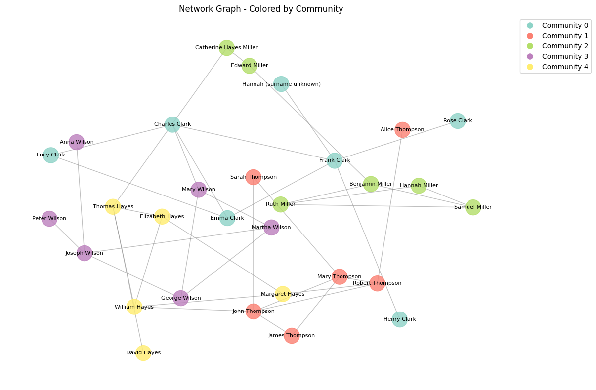

Made an edgelist (graveyard_net.csv) from Dr. Graham's family cemetery data, with columns for source, target, type of relationship, and whether the relationship is stated or uncertain.

Noticed that Catherine appears twice: as "Catherine Miller" in the Hayes family and as "Catherine Hayes" in the Miller family, with the same dates. I treated her as one person.

Marked the two "joint headstone?" entries and Frank Clark's possible first wife as uncertain.

Adapted the code from the ORBIS notebook in Google Colab to load my edgelist and draw the network. Since the names were already in the edgelist, I didn't need a separate nodes file, and I removed the parts that referred to Rome.

The cells networkx.degree(G) and networkx.betweenness_centrality(G) gave an error because the library was imported as nx, so I deleted them.

Calculated degree and betweenness centrality. Thomas Hayes and Catherine had the highest betweenness, since they connect the Hayes family to the Millers.

Ran the community detection. It found five communities that match the five families, with a modularity score of 0.699.

Added a cell to run the network again with only the stated relationships. This split it into three groups instead of two.

Figure 1. Network of the family cemetery, generated in Google Colab.

